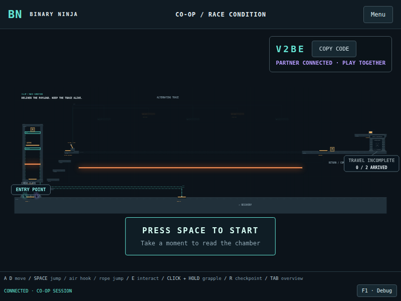
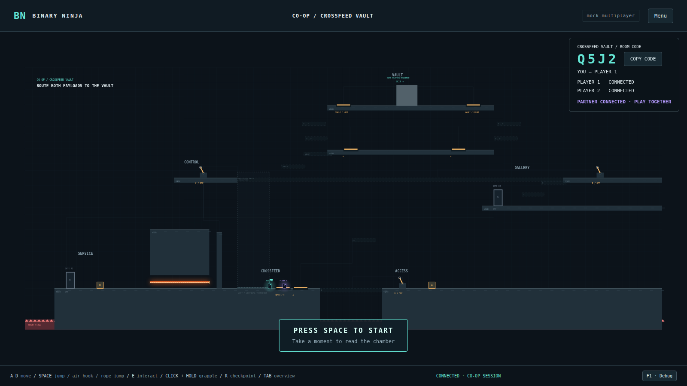

# Binary Ninja

**A browser-based, two-player cooperative puzzle-platformer built around a debugger-inspired world.** Work together to redirect power, carry shared payloads, activate platforms and grapple across changing terrain. The puzzles come first; reverse engineering gives their machinery its identity.

**[Play Binary Ninja](https://comp4020-final-ky787.fly.dev/)** · **[Public Level Builder](https://comp4020-final-ky787.fly.dev/workbench.html)** · **[My Levels](https://comp4020-final-ky787.fly.dev/my-levels.html)** · **[View the deployed README](https://comp4020-final-ky787.fly.dev/readme/)** · **[Development process](PROCESS.md)**



Built for **ANU COMP8020 / COMP4020 — Agentic Coding Studio**. This is an evolving final project: the public co-op campaign is playable, the public level builder saves drafts in your browser, and binary-backed gameplay is implemented in the single-player CONTROL SPINE showcase. The co-op chambers currently use authored controllers, **not** generated binaries.

## Play the game

The game has two main modes:

| Mode | Chambers | Purpose |
| --- | --- | --- |
| **Tutorial** (single player) | **PRESSURE**, **SWITCH**, **RELAY**, **CONTROL SPINE** | Learn plates, switches, cubes, grappling and machinery. CONTROL SPINE introduces verified binary-backed behavior. |
| **Co-op Campaign** (two players) | **HANDSHAKE**, **CROSSFEED VAULT**, **RACE CONDITION**, **DEADLOCK**, **USE AFTER FREE** | Coordinate reversible routes, shared cubes, relays, timed machinery, grapple traversal and a two-person finish. |

To play co-op:

1. On one browser, choose **CO-OP CAMPAIGN → CREATE PARTY**.
2. Share the four-character party code with another person. They choose **JOIN PARTY** from a **different device or browser profile**.
3. The creator is the party's host and chooses the chamber. Both players can operate the puzzle; neither has a fixed gameplay role.
4. Solve the machinery together, then **both physically enter the unlocked exit** to finish. The host can choose the next chamber, replay, or select another chamber.

Only HANDSHAKE and CROSSFEED VAULT currently display BREAKPOINT machines. Walk through one to activate it automatically; CROSSFEED’s SYSTEM ONLINE remains a separate E interaction. RACE CONDITION retains its internal cargo recovery milestone. DEADLOCK and USE AFTER FREE respawn at entry.

Party membership, checkpoints and meaningful puzzle progress survive reconnects and server restarts. The same party code works across campaign chambers. Selecting or replaying a chamber starts that chamber fresh while preserving its completion badge. There is no matchmaking, account system or public spectator mode.

The optional mechanics laboratories used during development are preserved behind `?labs=1` for local regression and experimentation, but are not part of the public campaign.

### Controls

| Input | Action |
| --- | --- |
| **A / D** or **Left / Right arrows** | Move left / right |
| **Space**, **W**, or **Up arrow** | Jump |
| **Space while airborne** | Attempt to hook an available grapple anchor |
| **Space while attached** | Jump off / release the grapple |
| **Hold left mouse button** | Aim and hold a grapple; release to let go |
| **E** | Interact with a switch, terminal or cube; pick up / put down payloads |
| **S / Down arrow** | Down / drop through supported surfaces |
| **R** | Reset your own player to the current checkpoint |
| **Hold Tab** | Show the room overview |
| **Esc** | Pause or return to the menu |

Some controls are contextual. In co-op, resetting or dying affects your own player rather than restarting your partner's progress. The room overview and contextual camera reveals help show what a distant control changes.

### What makes a Binary Ninja puzzle?

- **Physical cooperation:** one player powers a route, moves a payload or operates a switch so the other can cross—and later has to regroup.
- **Reversible machinery:** changing a control can make one platform solid while another becomes a non-solid ghost. Players must communicate about the current state.
- **Shared payloads:** named cubes can be carried, grapple-pulled, used on pressure plates or sockets, relayed and handed between players. Sockets accept resting cubes only and release when cargo leaves; ordinary plates also accept grounded players. DEADLOCK powers its personnel service relay when all three payloads are received, so both players finish with the cubes still upstairs. The socket graphics redesign is pending.
- **Platforming:** grapple anchors, jump paths, partner-held cube boosts, lifts, hazards and unstable blocks make the spatial layout part of the puzzle rather than decoration.
- **Readable infrastructure:** illuminated connections, entry-point gates, breakpoint pedestals and exit status displays explain the state of the chamber.



The co-op chambers remain subject to human playtesting. Their authored mechanics are documented in [HANDSHAKE](docs/chambers/handshake.md), [CROSSFEED VAULT](docs/crossfeed-vault.md), [RACE CONDITION](docs/race-condition.md), [DEADLOCK](docs/chambers/deadlock.md) and [USE AFTER FREE](docs/chambers/use-after-free.md). The three newest chambers have automated two-player traversal evidence; human playtesting is still outstanding.

## Real binaries and reverse-engineering evidence

The design deliberately separates **hand-authored level geometry**, **coordinate-free controller logic** and **verified binary evidence**.

The fourth tutorial chamber, **CONTROL SPINE** (internally `uplink`), uses a validated Windows x64 controller built with **O-LLVM-16 bogus control flow**. Its retained evidence includes disassembly, execution traces, checked logical outputs and binary identities. The game can display real machine instructions and inspect trace-associated behavior.

One optional unstable region is associated with a separately supported bogus-code classification: a cloned block with proven infeasible incoming paths. The block's physical collapse timing remains an **authored gameplay metaphor**, not literal processor behavior. Displayed authored string effects and the other tutorial controllers are likewise not presented as native binary evidence.

**Current evidence boundary:** All five co-op campaign chambers and workbench drafts use authored/mock controllers. Their signal changes are real game behavior, but they are **not yet backed by newly compiled, obfuscated binaries**. The intended longer-term workflow is to accept a fun puzzle first, freeze its logical contract, and only then generate and validate a matching binary. Unobserved execution alone is never treated as proof that a block is bogus.

See [CONTROL SPINE's design and evidence notes](docs/c8-vertical-slice.md) and the checked data in `game_data/`.

## Real-time multiplayer design

Binary Ninja uses a hybrid authority model to keep movement responsive while giving the puzzle a single consistent state:

```text
Player 1 browser                  Player 2 browser
Local movement + grapple         Local movement + grapple
Local presentation               Local presentation
          \                      /
           \    HTTPS / WSS      /
            Node game server
      Party / checkpoint / progress
      Controls / puzzle outputs
      Shared-cube authority
                  |
        Durable state in /data
```

Each browser simulates its own player movement. The Node server decides which interactions are accepted, computes shared machinery state, arbitrates who simulates or carries each shared cube, and records meaningful progress. Remote players are interpolated for display; the game does not attempt fully server-authoritative physics or anti-cheat movement verification.

Each cube has one accepted simulation authority at a time, with epoch/sequence checks to reject stale updates. Controls and relevant interactions are reconciled against the shared state. Reconnecting players recover their identity and checkpoint without duplicating cubes or losing earned exit progress.

These choices and their alternatives are documented in [ADR 0001 — Multiplayer authority](docs/adr/0001-multiplayer-authority.md), [ADR 0002 — Shared cubes](docs/adr/0002-shared-cube-authority.md), [ADR 0009 — Persistent parties](docs/adr/0009-persistent-coop-parties.md), and the [multiplayer implementation record](docs/c9-multiplayer.md).

## Level Workbench — for people and coding agents

Choose **LEVEL BUILDER** from the game menu, or open the [Public Level Builder](https://comp4020-final-ky787.fly.dev/workbench.html) directly. Author levels on your own, then test or play them with a friend using the existing cooperative game engine.

| Mode | Saving | Playtesting |
| --- | --- | --- |
| **Public Level Builder** | IndexedDB on this browser and website origin; JSON import/export | Solo physics preview, TEST WITH FRIEND, and saved-level PLAY WITH FRIEND |
| **Local Developer Workbench** | Canonical files in `levels/drafts/`, shared with Codex and CLI | Local physics plus isolated local two-player draft sessions |

Start with **New** or **Examples**, place objects from the palette, and choose **Play from spawn**. **Stop test** restores your authored document and editor camera. **Save** keeps the complete draft in this browser; **My drafts** reopens it later. Save copy, Rename and Delete draft manage browser copies. **BACK TO GAME** returns to the campaign without changing your progress or party membership.

Canonical drafts stay in **IndexedDB in your browser** and do not sync between devices or profiles. Starting TEST WITH FRIEND or PLAY WITH FRIEND uploads only a validated frozen copy to a temporary, memory-backed room on Fly.io. Clearing site data, private browsing or browser storage eviction can remove them. **Export JSON** regularly for durable backups and sharing. **Import JSON** accepts a local file, validates it and creates an independent browser draft without overwriting an existing one. To edit a friend's export with Codex, use Import JSON in the local workbench, then Save into `levels/drafts/` (or copy the JSON there directly and validate it). Local exports import into the public builder in the same way.

It has two interfaces to the **same versioned JSON draft**:

- **For people:** a grid-based canvas, drag-and-drop objects, resize handles, a property inspector, functional connections, a logic editor, saved signal-state previews, undo/redo, and WASD camera panning.
- **For coding agents:** readable `levels/drafts/*.json` documents plus CLI commands to validate, render and playtest a draft without GUI clicking.

Both routes use the existing `PuzzleRenderer` and `PuzzleWorld` physics. A physics preview records actual movement and grapple trajectories rather than guessing which jumps are possible. Public and local two-browser draft sessions reuse the real multiplayer system; they do not award campaign progress. Draft editing does not alter accepted campaign chambers.

The declarative controller supports Boolean **AND / OR / NOT**, device inputs and named output bindings. More complex imported chambers retain their existing trusted controller implementations. Decorative wire paths are not executable logic.

New code platforms default to **Always Powered**, so geometry can be playtested immediately. The inspector also offers **Controlled by Signal** (a valid binding is required) and **Always Inactive** (ghosted). Connect selects controlled mode. Older version-1 files without an activation field keep their original controlled behavior, including errors for missing bindings.

**TEST WITH FRIEND** opens a separate game tab with a four-character code and invitation link. Unsaved editor work stays in the original tab. The invited friend needs no JSON file or editor. Two tabs sharing a visitor cookie are one player; use separate browser profiles or devices. Test information is optional and read-only.

**MY LEVELS** opens the browser-local collection directly from the game menu. Choose **EDIT**, **PLAY WITH FRIEND**, **EXPORT JSON**, or confirmed **DELETE**. Normal custom play hides diagnostics and editing controls. Both players reach the exit to finish; the host can **REPLAY LEVEL** with a new session generation. Saved maps remain intact. To revise a test, return to the editor, edit/save, and start a new room; running snapshots never change.

Public rooms expire after two hours, or five minutes after both players disconnect. Unlaunched uploads expire after two minutes. Server restarts end these rooms. No custom draft or custom room is written to `/data`, published in a gallery, or added to campaign saves/badges. Limits include eight active rooms, 256 KB per snapshot, 2 MB total canonical snapshot bytes, and three staged/active sessions per visitor. Save/Export is how you keep the original.

Placing a **Breakpoint** also creates missing Player 1 and Player 2 respawn markers on nearby clear static ground in one undo step. The inspector links to each independently movable marker. Existing markers are reused. If no safe position is found, move the pedestal or add the missing markers manually. Walk through the pedestal at floor level: either player activates the shared checkpoint without E. Server acceptance raises the flag and plays its existing audio once, without teleporting anyone. Separate puzzle terminals still require E. A cooperative exit requires latched unlock and two arrivals.

Editing remains single-user. No shared cursors, remote editing permissions, cloud draft synchronization, permanent publishing or accounts are involved. Custom controllers and prototype crumble remain authored/mock.

Read the [Level Workbench guide](docs/level-workbench.md) for the full GUI workflow and [agent authoring guide](docs/level-authoring-for-agents.md) for the schema and command-line workflow.

## Run locally

The repository pins **Node.js 24.21.0** and **pnpm 11.9.0** in `mise.toml`. With [mise](https://mise.jdx.dev/) installed:

```bash
mise install
pnpm install --frozen-lockfile
pnpm dev
```

Open the development URL printed in the terminal (normally **http://localhost:5173**). `pnpm dev` starts the Vite client, the Node HTTP/WebSocket server (normally port 8080), and a loopback-only Level Workbench service. Select **LEVEL BUILDER** from the local game menu. Stop all three with **Ctrl+C**.

To launch the editor independently:

```bash
pnpm workbench
```

Open the workbench URL printed in the terminal. Draft files live in `levels/drafts/`; temporary workbench state and reports live in `.workbench/`. Local game saves use `.local-data/` unless `DATA_DIR` is configured.

### CLI level authoring

```bash
# Start a machine-readable draft
pnpm level:new levels/drafts/my-chamber.json

# Import a safe copy of an existing chamber
pnpm level:import race-condition --out levels/drafts/race-copy.json

# Validate an agent- or human-edited draft
pnpm level:validate levels/drafts/my-chamber.json --json

# Render the actual game's view of a draft
pnpm level:render levels/drafts/my-chamber.json \
  --out .workbench/reports/my-chamber.png

# Run a bounded real-input physics scenario
pnpm level:playtest levels/drafts/blank-room.json \
  --scenario levels/scenarios/blank-physics.json \
  --report .workbench/reports/blank-physics
```

The rendering and browser scenario tools require a locally available Chromium-family browser. The [workbench documentation](docs/level-workbench.md) describes browser selection, preview modes, test limitations and co-op draft sessions. **Successful scripted traversal is evidence that a particular route works, not proof that a level is fun or contains no shortcuts.**

## Test and deploy

```bash
# Type checking and automated tests
pnpm check

# Production client build, including CONTROL SPINE bundle validation
pnpm build

# Real-input two-player campaign regression
pnpm check:campaign

# Production public builder (run pnpm build first)
pnpm check:public-builder
pnpm check:public-coop

# Local editor browser workflow
pnpm check:workbench
pnpm check:workbench-menu

# Validate the retained process/evidence references
pnpm check:evidence
```

`pnpm check` is also the main course CI command. The GitHub workflow builds the deployment image, checks the running HTTP app and `/readme/` page, validates process evidence and scans for secrets. On successful pushes to the public `main` branch, it deploys to **Fly.io** and checks that the public site responds. Browser/end-to-end checks beyond that core CI gate are available through the separate scripts above; they are not a substitute for two-person playtesting.

## Repository guide

| Path | Contents |
| --- | --- |
| `src/slice/`, `src/engine/`, `src/render/` | Game loop, physics, camera, rendering and tutorial controllers |
| `src/coop/`, `server/` | Multiplayer clients, shared authority, party state and chamber logic |
| `src/workbench/`, `scripts/level-tools/` | Level editor, JSON schema, validation, local draft sessions and agent-facing CLI |
| `levels/drafts/`, `levels/scenarios/` | Editable level definitions and bounded playtest scenarios |
| `game_data/` | Retained CONTROL SPINE controller evidence bundle |
| `docs/`, `docs/adr/` | Puzzle contracts, architecture decisions and testing notes |
| `spec/`, `tests/`, `scripts/` | Course checks, unit tests and browser/end-to-end harnesses |
| `PROCESS.md`, `reflections/` | Development process, commit evidence and personal crit reflections |
| `CLAUDE.md`, `AGENTS.md` | Instructions and constraints for coding agents |

## Development approach and current limits

Binary Ninja has been built iteratively with coding agents and human playtesting. Early experiments showed that generating a physical level directly from an obfuscated control-flow graph—or asking a model to invent all spatial geometry at once—did not reliably produce enjoyable puzzles. The project moved to **gameplay-first, evidence-second** design: author and test a readable cooperative challenge, then attach verified reverse-engineering evidence where it genuinely matches.

The current challenges are improving puzzle spatial design and playtesting, expanding the campaign, and eventually making binary generation more repeatable for accepted co-op controllers. The workbench is intended to make the first two problems easier for both human designers and agents; it is **not** an automatic puzzle-quality evaluator or a binary compiler.

For the development history and decisions, see [PROCESS.md](PROCESS.md), the [crit reflections](reflections/), and the [architecture decision records](docs/adr/).

**Project goal:** make a compelling cooperative platform puzzler first—and give its unusual machinery authentic reverse-engineering depth without requiring players to understand assembly to have fun.
