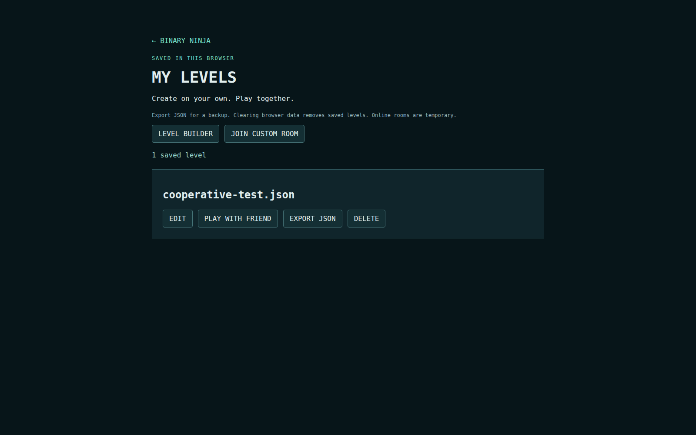
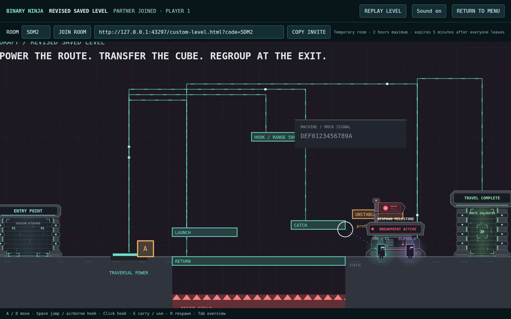
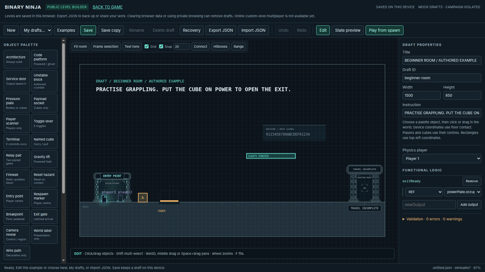

# Binary Ninja Level Workbench — custom multiplayer and local development

One editor provides a public browser backend and a local developer backend. Its canonical JSON, validator, controller evaluator,
`PuzzleWorld` physics and `PuzzleRenderer` are shared by the graphical editor and
command-line tools. Drafts are authored/mock content. They do not replace campaign
rooms, award campaign badges, or inherit verified binary evidence.

## Public Level Builder

Open [the public builder](https://comp4020-final-ky787.fly.dev/workbench.html) or select **LEVEL BUILDER** in the game menu. No account, developer token or local service is needed. **BACK TO GAME** returns on the same origin; visitor identity, tutorial progress and persistent party membership are preserved. The builder never reads or writes the campaign progress API.

1. **New** opens a beginner draft; **Examples** offers a beginner room and a multi-signal room. Every copy is independent and authored/mock.
2. Place, drag, resize and configure objects using the existing palette and inspector. New code platforms are Always Powered, so a new slab needs no controller work to playtest. **Connect** selects Controlled by Signal and creates a functional binding plus a decorative wire.
3. **State preview** shows evaluated inputs or explicitly labelled forced-output diagnostics. **Play from spawn** runs the actual single-player engine; stop restores the document, selection and editor camera. Recordings can be exported but are never saved in IndexedDB.
4. **Save** creates or updates a browser draft. **My drafts** lists saved levels. **Save copy** creates a fresh stable storage ID, even when the document ID is the same. Duplicate filenames receive numbered suffixes. **Rename** changes the library filename, preserving the document title and authored ID. **Delete draft** requires confirmation and leaves current editor content available for export as an unsaved copy.
5. **Export JSON** downloads the canonical document. Incomplete drafts use an `-incomplete.json` filename and a visible warning; malformed documents are rejected. **Import JSON** uses a local file picker, never uploads the file, and creates an independent draft. Remote URL imports are unsupported.

IndexedDB records belong to the exact site origin and browser profile. Ordinary refresh/reopen retains saved drafts. Private browsing, clearing site data, storage eviction, changing origin or using another device can make drafts unavailable. **Export JSON is the durable backup and sharing path.** Browser saving is not a cloud service.

Recovery snapshots are debounced after edits and flushed before switching documents. Confirming a switch preserves an independent recovery copy; **Recovery** lists and removes these copies. Startup offers the latest unsaved recovery. Sudden process termination before a recovery write completes may lose recent edits. Save/Export before closing. Recovery contains canonical documents only, never gameplay recordings.

Two tabs use transactional revision and SHA-256 comparisons: stale Save, Rename and Delete operations fail and preserve both the newer saved draft and current edits. Reload or Save copy resolves conflicts. A storage-full, unavailable, blocked or upgraded-database error is visible; it never marks unsaved edits saved. Current work remains editable, playable where valid, and exportable. Close other builder tabs and reload for a blocked upgrade; export before clearing any site data.

### Test with a friend and play saved levels

**TEST WITH FRIEND** validates the current document and uploads a frozen canonical snapshot, including unsaved edits. Its separate `/custom-level.html` game tab uses the actual multiplayer engine. The original editor and undo history stay open. Copy its invitation link (`/custom-level.html?code=K7MD&mode=test`) or share the four-character code; the friend opens that link or **MY LEVELS → JOIN CUSTOM ROOM**. Different players need different visitor cookies (separate devices, profiles or private contexts). Joining the same cookie replaces that player's connection, never allocates Player 2.

The host is Player 1, guest Player 2. Both load the same SHA-256-verified document after joining. Shared logical state, cubes, checkpoints and unstable platforms use the existing server authority, while each client simulates its character. **TEST INFORMATION** optionally displays read-only observations; it cannot force outputs, move objects or modify the session. Return to the editor to revise and save, then launch a fresh room. Changes do not alter the previous room.

**MY LEVELS** (`/my-levels.html`) lists this browser's saved collection without opening the editor. Each entry has **EDIT**, **PLAY WITH FRIEND**, **EXPORT JSON** and confirmed **DELETE**. EDIT opens that precise storage record. PLAY WITH FRIEND freezes the saved version and opens normal gameplay; no grid, editing handles, diagnostic controls or forced-input panel appears. Both players must reach the exit. The victory screen lets the host replay; the guest waits. Replay resets shared puzzle state with a new generation and rejects old messages. It never unlocks an official chamber or awards a campaign badge.

Public rooms are temporary: maximum two hours, or five minutes after the last participant disconnects. An uploaded snapshot not launched within two minutes is released. A server restart ends every public custom room; return to the saved browser map and create another. Reconnection within retention preserves the participant slot and authoritative state. Maximum limits are eight rooms, 256 KB per uploaded/canonical snapshot, 2 MB total canonical snapshot bytes, three staged/active sessions per visitor, three registration attempts per visitor/minute and twelve globally/minute. Staging and room expiry release unreferenced snapshots. Error messages explain full, missing, expired, invalid or interrupted sessions. There is no permanent server publishing or online draft list.





### Breakpoint markers

A Breakpoint pedestal is presentation, not a respawn position. Placing it creates each missing `checkpoint` marker for the same milestone and slots 1/2, in the same undo operation. The search uses permanent static footing within 320 horizontal and 200 vertical units, clear of collision geometry, hazards, firewalls, cubes, gates, lifts and the other marker. It conservatively avoids conditional platforms even if currently ghosted. Existing markers are never moved or duplicated.

The inspector shows linked marker coordinates and **Select / frame** controls. Drag markers independently. Duplicating pedestals reuses the milestone markers (selected checkpoint markers are not duplicated); deleting a pedestal does not cascade into markers. Changing the pedestal milestone creates missing markers for the new milestone without deleting the old ones. If clear footing is unavailable, missing markers remain blocking diagnostics: move the pedestal near clear architecture and choose **Create missing respawn markers**, or place/configure them manually. Static placement checks are not a proof of puzzle reachability.

Configure a terminal or supported toggle with the same **Checkpoint**, then choose that device as the pedestal's **Activation control**. Existing activation semantics apply: server-accepted activation raises the flag and shows BREAKPOINT ACTIVE, does not teleport players, and each later respawn uses that slot's marker. Walking over a pedestal alone does not activate a checkpoint.

### Exchange with the local developer workbench

Send the downloaded JSON file to another person. Locally, choose **Import JSON** and **Save** with a new filename in `levels/drafts/`. Codex can edit that exact JSON and run `pnpm level:validate levels/drafts/name.json --json`. Alternatively copy the file into `levels/drafts/` and open it from the local toolbar. Use Export JSON in either mode to send it back. Canonical coordinates, metadata, Boolean expressions, wires, bindings and preview states are preserved; the separate browser storage ID/revision is not part of the level format. Document IDs may legitimately repeat across independent copies.

Public physics preview has one real player. Two-arrival exits and allowlisted imported co-op chambers cannot be certified completed by this preview. No simulated input is a second networked player. Use **TEST WITH FRIEND** for actual cooperative testing; campaign multiplayer remains independent. New public templates use two-arrival exits. Older one-arrival drafts must explicitly change the exit inspector to Physical arrivals: 2 and enable Latch unlock before cooperative play.



## Local Developer Workbench

```sh
pnpm dev
# Open the printed game URL, then choose LEVEL BUILDER on the main menu.
# The editor has a Back to game link.

# Standalone editor:
pnpm workbench
# optional: pnpm workbench --port 4175
```

`pnpm dev` starts the game's API, Vite frontend and isolated loopback builder in one
process. It prints both URLs; the builder uses an available port by default
(`DEV_WORKBENCH_PORT` can select one). Ctrl+C stops all three listeners. Game saves
remain in `DATA_DIR` or `.local-data`; builder recovery/sessions stay in `.workbench`
(`WORKBENCH_DATA_DIR` can override that directory).

For the standalone editor, open the printed `http://127.0.0.1:4174/` URL. The process
prints the canonical draft root and local data directory. Stop with Ctrl+C. Node 24 and the repository's pnpm
dependencies are required. CLI screenshots and scenarios also need Chromium (the
existing browser harness searches installed Chromium/Chrome/Brave; `BROWSER_BIN`
can name an executable). No LLM service or subscription is involved.

## First use

1. Open `blank-room.json` from the toolbar. Use **Fit room**, then zoom with the
   wheel around the pointer. In Edit and State preview, focus the canvas and hold
   WASD to pan at a constant screen speed; middle-button or Space+drag also pans.
   Typing in controls does not move the camera. Playtest keeps its gameplay keys.
   Select a palette item and click or drag it into the canvas. The inspector shows position/size and
   attributes; device positions are floor contacts, not rectangle corners.
2. Place a pressure plate and a code platform. Use **Connect**, select the device,
   then the target. Inspect the output expression and binding property. The logic
   inspector supports typed references, constants, AND, OR and NOT. Wires have
   their own editable bends; moving one never changes the expression.
3. Switch to **State preview**. Choose a saved input configuration or change device
   inputs. The resolved state drives ghosts, wires and machinery. Forced-output
   diagnostics are labelled separately and are not a gameplay result.
4. **Play from spawn** runs the actual engine. A/D or arrows move, Space jumps,
   click holds a grapple, E carries/uses, and R resets. Stop restores the authored
   document, selection and editor camera. Inspect/export the measured path.
5. Save directly to `levels/drafts`. To test together, choose **TEST WITH FRIEND**.
   Share its four-character room code with a separate browser profile or private
   window on the same computer. Open `/workbench-runner.html?code=CODE` there.
   Two ordinary tabs with the same cookie are the same player.

The editor includes multi-selection (Shift), numerical properties, corner resize
handles, duplicate/delete, undo/redo, search, a hierarchy with hide/lock controls,
grid/snapping, frame selection, hitboxes and a grapple-range guide. A completed
pointer drag is one undoable operation. Form controls retain their keyboard input.
Validation diagnostics can select/frame affected objects. Dirty replacement is
confirmed; a disk conflict offers reload or save-copy without overwriting the disk
version. Recovery data lives separately under `.workbench/recovery.json`.
Service writes are serialized and check the expected hash before replacement.
This is optimistic conflict detection: arbitrary external file writes are not part
of a filesystem-wide transaction. Finish a file edit before saving from the GUI;
continuous concurrent writers can race the final hash check and atomic rename.

## Canonical files and coordinates

- `levels/drafts/*.json`: canonical, human/agent-editable documents.
- `levels/scenarios/*.json`: bounded real-input scenarios.
- `src/workbench/`: model, shared validator/evaluator, adapters, GUI and local runner.
- `scripts/level-tools/`: CLI, file service and browser orchestration.
- `.workbench/`: ignored recovery, ephemeral sessions and diagnostic reports.

Version 1 (including optional code activation modes) is defined by `src/workbench/model.ts`; runtime validation is
`src/workbench/validation.ts`. Unknown fields/versions and malformed structures are
rejected with a diagnostic instead of silently discarded. Structurally valid but
incomplete drafts can be saved. Gameplay errors block Play and frozen sessions.

Coordinates use game pixels/world units: x increases right; y increases down.

| Object or field | Position convention |
| --- | --- |
| Spawn/checkpoint | Player body centre (body 22 × 34) |
| Named cube home | Cube centre (44 × 44) |
| Plate/socket/scanner/toggle/terminal/breakpoint | x centre, y floor contact |
| Platform/lift/relay/reset hazard/exit/camera bounds | Top-left rectangle, w/h positive |
| Firewall | Top-left lethal rectangle; orientation, length and thickness |
| Label/wire point | World point (text baseline for label) |

Example: on a floor at y=680, the player centre is y=663, cube centre y=658, and
plate floor contact y=680. Entry gateways and breakpoint pedestals reuse the game
assets; they do not define collision geometry themselves.

The document separates `geometry.objects`, `controller`, functional `bindings`,
`presentation` (wires, labels, camera reveals/display) and `editor` metadata. Array
order is preserved as intentional drawing order. Canonical serialization sorts
object keys, uses two-space indentation and a final newline, and has no changing
save timestamps. SHA-256 of canonical serialization is shared by CLI and browser.
Stable IDs begin with a letter and contain up to 64 letters/digits/underscores/
hyphens. Renaming or duplicating groups updates their internal references; external
connections remain explicit. Unsupported imported factory fields block import.

## Objects, logic and connections

Platforms are `static`, `code`, or authored `unstable`. Static architecture is always
solid and unhookable. Code platform `activation` modes are:

| JSON value | Inspector | Semantics |
| --- | --- | --- |
| `always-powered` | Always Powered | Solid and hookable where permitted; no binding |
| `signal` | Controlled by Signal | Valid `active` binding required; resolved output controls solidity/hooks |
| `always-inactive` | Always Inactive | Ghosted and unhookable; no binding |

New palette code defaults to `always-powered`. Version-1 omission explicitly defaults to `signal`, preserving old behavior even when the old binding is missing. Saving a legacy document need not rewrite its missing field or hash. Unknown values, activation fields on other platform kinds, conflicting constant-mode bindings, invalid references and malformed bindings are rejected. Selecting a constant mode in the inspector removes that target's binding and associated wire in one undoable edit; applying a connection selects `signal`. Unused outputs are warnings and do not block Playtest. Missing controlled bindings remain errors.

Controlled code is a ghost while disabled; enabled floating
slabs accept hooks across the address bar. Unstable blocks expose foot/hook warning
and respawn timing. They are prototypes, never proof of bogus binary code.

Ordinary plates accept grounded players or resting cubes. Sockets accept cubes.
Scanners accept players. Toggle controls change Boolean value each interaction;
terminals commit once. Their output ports are `id.occupied` and `id.value`.
Reachable ordinary draft cubes have no progression gate on pickup. Existing trusted
built-in controller requirements remain explicit in imported drafts.

```json
{
  "kind": "declarative",
  "outputs": {
    "leftRoute": {
      "op": "and",
      "args": [
        { "op": "ref", "id": "powerPlate.occupied" },
        { "op": "not", "arg": { "op": "ref", "id": "routeLever.value" } }
      ]
    },
    "rightRoute": {
      "op": "and",
      "args": [
        { "op": "ref", "id": "powerPlate.occupied" },
        { "op": "ref", "id": "routeLever.value" }
      ]
    }
  }
}
```

References may name a device port or another output. Unknown references and
combinational cycles are errors. There are no executable expression strings, timer
languages or uploaded code. Each binding names an output, target, and property:
`active` (platform/firewall), `open` (service door), `power` (lift/relay), or `unlock`
(exit). `invert` is applied once to destination power. Several targets can share
one output. Wires reference a binding or output; lit functional wires follow the
resolved destination including inversion. Decorative routes are separate.

Relay objects name a pair (exactly two gates), with an exit direction -1 or +1.
Both gates must agree on power. Firewall dimensions describe the lethal rectangle.
Checkpoint markers retain each player's own centre; breakpoint assets and controls
explicitly name the checkpoint. Camera reveals name a source device and platform
IDs and/or bounds, with world-unit padding and seconds duration.

Built-in controllers are allowlisted by ID/version, including RACE CONDITION,
CROSSFEED VAULT and the existing labs. Their internals remain code-owned. Geometry
and bindings are editable; changing required IDs produces diagnostics. Cargo Clock,
handovers and authoritative crumble use existing controller implementations, not
logic inferred from decorative wires. `CONTROL SPINE` and binary artifacts are not
part of the importer.

## Modes and test evidence

**Edit** stops simulation. **State preview** evaluates explicit input values and can
also show a labelled forced-output diagnostic. An input configuration is not a
proof it is reachable. Neither preview mode writes progress.

**Playtest** clones the document, uses existing movement, collisions, grapple,
cube support, relay/lift/firewall code and records actual paths/events. Test from a
marker or point checks active geometry and hazards before starting. Local physics
preview is one player; simulated partner inputs are diagnostics. It cannot certify
a two-person exit. Pause/frame stepping is local only.

Recordings identify the draft hash, engine revision and scenario. Public recordings identify the hashed compiled editor module (including its versioned engine imports); local recordings use the Git revision. Edits make old
paths stale. Range/clearance guides are hints; measured paths are shown separately.
Static validation cannot prove reachability, absence of softlocks or puzzle quality.
A passing scenario proves its stated assertions in its tested configuration only.

A co-op test freezes one validated snapshot with a content hash and fresh instance
generation. Both identities download and verify it. Avatar physics stays local;
shared outputs, controls, timers, crumble and cube grants remain on the existing
WebSocket authority. One player may hold/pull one cube, and each shared cube has one
accepted simulator. Saving edits does not change a live room. The host runner's
**Latest draft / Host: restart snapshot** explicitly loads the saved file, freezes
it, restarts both clients and rejects traffic from the old generation. Completion
uses the draft's controller and two distinct arrivals and awards no campaign badge.
Co-op requires a latched exit with `arrivals: 2`; other exit configurations remain
available to local preview. Frozen snapshots live in memory: restart the test after
restarting the workbench service.

## Command-line workflows

```sh
pnpm level:new levels/drafts/my-room.json
pnpm level:import race-condition --out levels/drafts/my-race-copy.json
pnpm level:validate levels/drafts/my-room.json --json
pnpm level:render levels/drafts/blank-room.json --state left-powered \
  --out .workbench/reports/left.png
pnpm level:render levels/drafts/race-condition-copy.json \
  --region 0,150,1600,900 --out .workbench/reports/race-region.png
pnpm level:playtest levels/drafts/blank-room.json \
  --scenario levels/scenarios/blank-physics.json \
  --report .workbench/reports/blank-physics
pnpm level:playtest levels/drafts/cooperative-test.json \
  --scenario levels/scenarios/cooperative-test.json \
  --report .workbench/reports/cooperative-test
pnpm build && pnpm check:public-builder
pnpm check:public-coop
pnpm check:workbench
pnpm check:workbench-menu
node scripts/level-tools/sharing-browser-check.ts # after check:public-builder
node scripts/level-tools/coop-browser-check.ts
```

New/import refuses to overwrite an existing destination. Direct file editing is
supported. Validation emits stable code/severity/object/message diagnostics.
Render uses the real browser renderer, checks browser errors and writes PNG plus
metadata containing state/hash/engine revision. Render defaults to the whole room;
`--region x,y,w,h` fits requested world bounds into a 1600 × 900 viewport;
extra context may appear when the aspect ratios differ. Commands return 0 on success, 1 for a failed
scenario, and 2 for malformed input, blocking validation or tool failure.

Scenarios use version 1 with `id`, explicit `scope` (`full-room`, `section-only`,
`diagnostic`), `mode` (`single`/`coop`), total `timeoutMs` and distinct actor IDs/slots.
Steps have labels, real-control actions, bounded waits and observable assertions.
A step's `actions` are dispatched in order; held keys persist across steps, so both
players can act concurrently. Supported actions are key down/up, tap, walk-to-x and
grapple target/release. A grapple aim helper maps object position through the real
camera and sends a real mouse action. No step can teleport or set outputs/cubes.
An explicit initial local start point/marker requires section-only/diagnostic scope.
Co-op scenarios always use authored spawns in two isolated browser contexts.

```json
{
  "version": 1, "id": "walk-check", "scope": "diagnostic", "mode": "single",
  "timeoutMs": 15000,
  "actors": [{ "id": "designer", "slot": 1 }],
  "steps": [{
    "label": "walk right",
    "actions": [{ "type": "walk", "actor": "designer", "x": 240 }],
    "assert": [{ "actor": "designer", "condition": { "path": "player.x", "min": 240 } }]
  }]
}
```

Conditions use a path under player/cubes/signals/controls/plates/session or
exitUnlocked/completed plus `equals`, `min`, `max`. All waits have a deadline; the
scenario is capped at five minutes. Failure reports include the step, last physical
observations, screenshots and measured trajectory JSON. Parse the saved
`report.json`; the pnpm wrapper can append lifecycle text to failed-command stdout. Browser contexts, service
and child processes are closed on success/failure/cancellation.

## Included examples

- `blank-room.json`: safe floor, two spawns, cube, plate, toggle, code platform and exit.
- `race-condition-copy.json` and `crossfeed-vault-copy.json`: imported geometry with
  their original allowlisted controller, including Cargo Clock and grace behavior.
- `relay-lab-copy.json`: small imported lab with paired gates.
- `cooperative-test.json`: small authored co-op route with cube takeover, real
  grapple segment, unstable block, latched return bridge and two-person exit.
- `multiple-machinery.json`: four named cubes and two relay pairs; targeted tests
  verify bounded authority, traffic, independent resets and controller contacts.

`blank-physics.json` is a diagnostic route. `cooperative-test.json` in the scenarios
folder is a full-room physical route; completion is required on both identities.
The separate frozen-session check tests save/restart/stale-message behavior and is
explicitly a session diagnostic, not route-completion evidence.

## Production boundary

Vite builds `index.html`, `workbench.html`, `my-levels.html` and `custom-level.html`. The production server serves those assets, existing game APIs and the bounded custom snapshot/member APIs. The public entry selects IndexedDB at compile time; only the loopback workbench's own Vite configuration enables the local adapter. URL parameters, draft metadata and API responses cannot enable it. Production excludes the local service, filesystem adapter and developer multiplayer runner; the build audits emitted modules. Pure allowlisted controller functions are reused for imported room previews, without their server transports or persistence.

Strict schema/size/complexity limits apply equally to both editors and CLI. Expressions are typed Boolean trees, never evaluated JavaScript. User text is escaped in DOM markup and drawn as canvas text. Unknown evidence fields and unallowlisted controllers are rejected; every draft runtime is mock and cannot obtain the CONTROL SPINE room/evidence identity from its document ID, title or labels.

Public custom rooms use the same validator, canonical hash, evaluator and room adapter through an authenticated temporary snapshot boundary. No filesystem service, permanent publishing, matchmaking or server-side draft database is exposed. See the architecture document for membership, lifecycle, rate and memory limits.

## Boundaries and current limits

Version 1 bounds: 1,000,000 document bytes; 384 objects; 8 named cubes; 48 devices;
8 relay pairs; 64 outputs; 192 bindings and 192 wires; 64 points per wire; 256 total
expression nodes at depth 16; room dimensions up to 9000 units. This is bounded
capacity, not arbitrary capacity. The local developer registry permits 32 frozen snapshots per service run; public sessions use the stricter temporary quotas described above.
Network limits scale with legitimate cube traffic while retaining rate limiting.

Version 1 supports one exit and up to 32 saved preview states.

Checkpoint milestones reuse the engine's `relay` and `upper` stages, with separate
positions for both player slots. Built-in imports retain their required IDs/cube
sets; arbitrary added control semantics belong in declarative drafts. Playable drafts
need both spawns and an exit even for local preview. The editor is single-author,
with conflict detection rather than collaborative cursor sharing.

The Level Builder menu option is available in production and development. `pnpm dev`
links to the dedicated filesystem workbench. `pnpm dev:client` alone uses the
browser-storage editor; start `pnpm workbench` separately and open its printed URL
when filesystem authoring is needed.

The developer service binds loopback only. Writes require the exact printed origin
and a random local capability. Filenames are flat `.json` names under the draft
root; traversal, absolute paths, symlink escapes and oversized requests are rejected.
The standard `pnpm start` production process serves the static public editor and has
no workbench write/diagnostic endpoints. No Fly configuration changes are needed.
Neither editor executes uploaded code, builds binaries or publishes levels.

Human editor feedback and puzzle/two-player acceptance remain necessary before
promoting drafts into the campaign. Automated diagnostic results are not a claim
of human puzzle acceptance.
